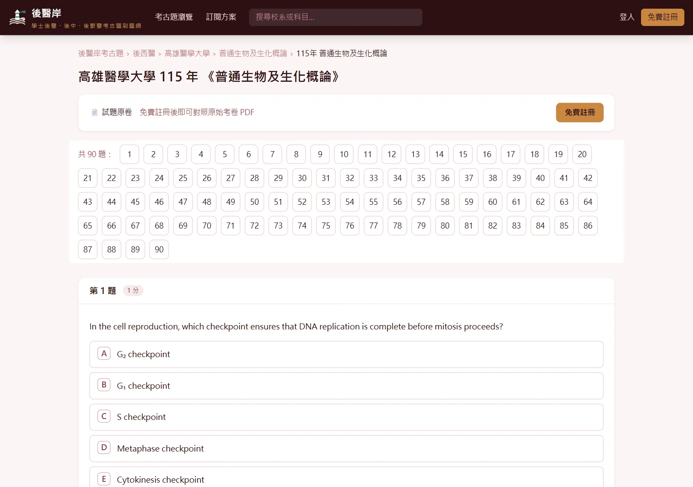
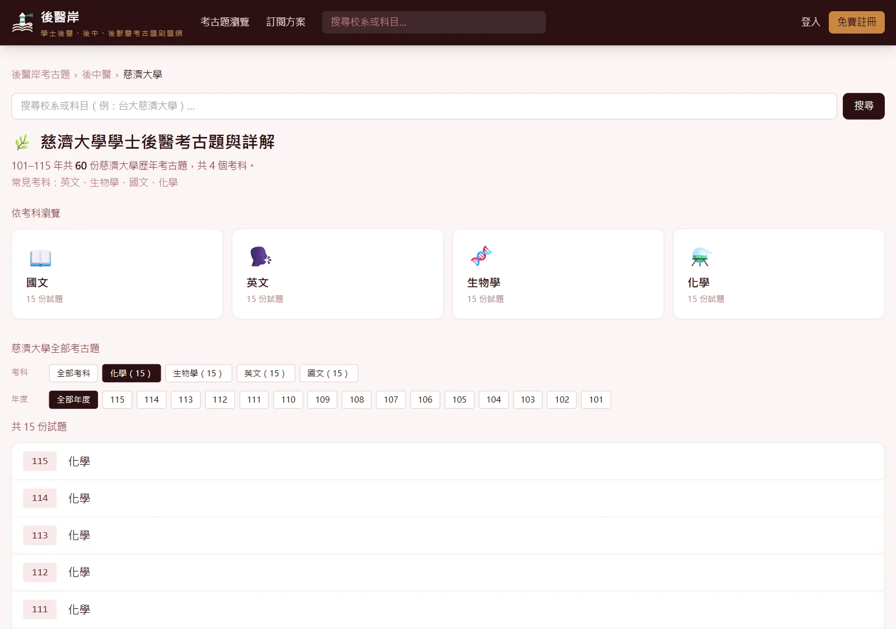
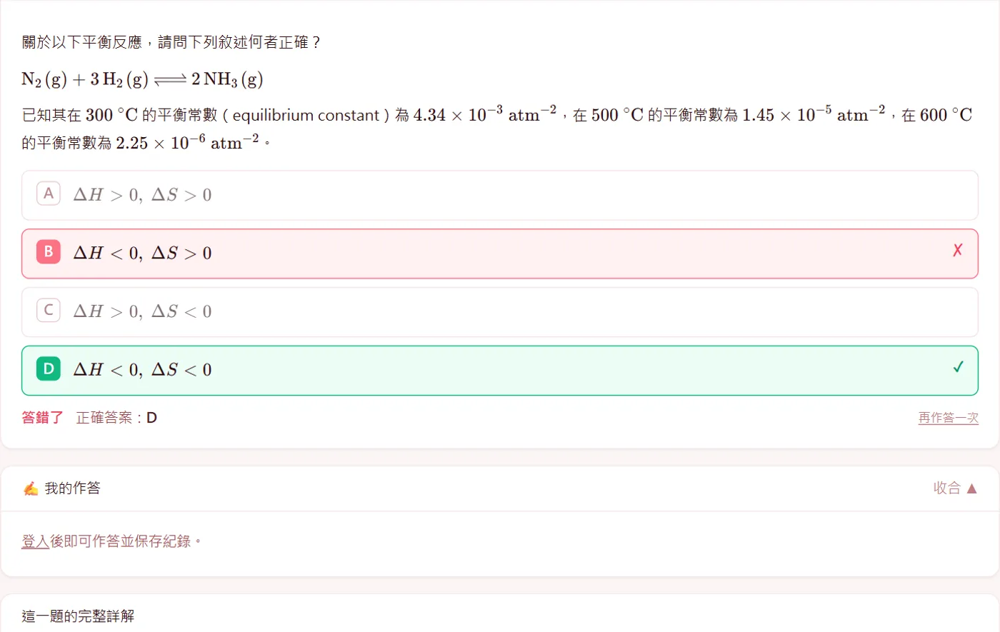
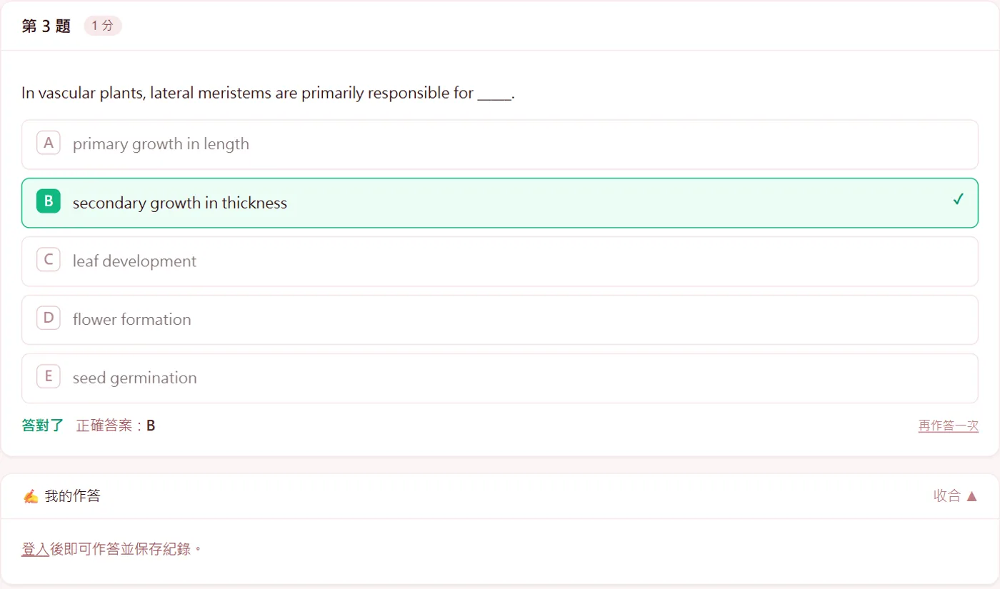
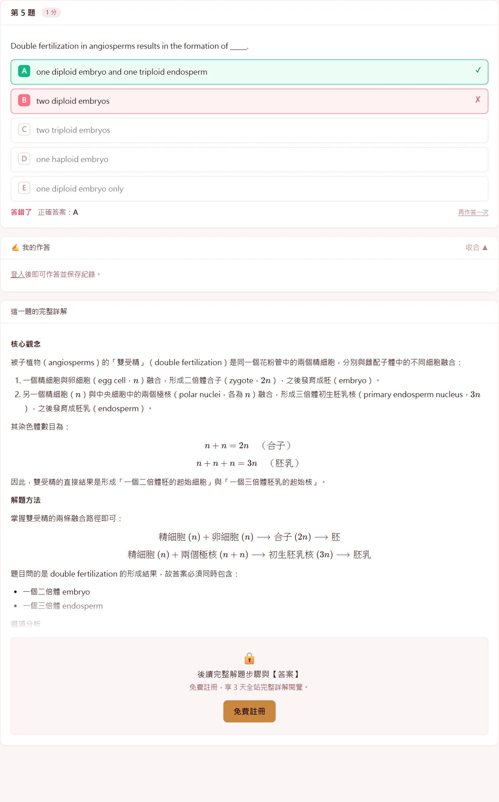
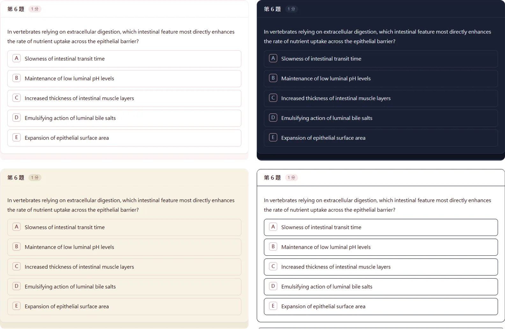
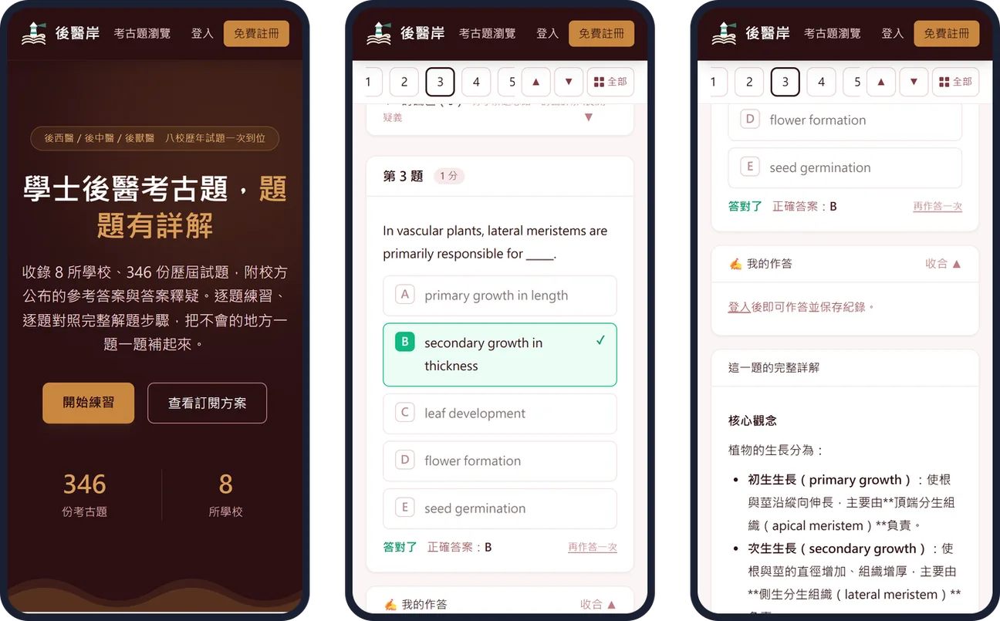

# 後醫岸｜學士後醫・後中・後獸醫考古題，逐題練習、逐題詳解

**網站：[postmed.examshore.com](https://postmed.examshore.com/)**
完整介紹頁：[b01b02014.github.io/postmed-exam](https://b01b02014.github.io/postmed-exam/)

後醫岸是台灣學士後醫的考古題練習網站。收錄後西醫（高醫、清華、中山、中興）、後中醫（中國醫、慈濟、義守）、後獸醫（亞洲大學）
共 8 所學校、98 到 115 年 **346 份**考卷，近 2 萬題逐題作答。答案以校方公布的參考答案為準，經答案釋疑更正、送分或多選給分的題目一併標註，
每題附完整詳解。一個帳號三種學制通用。

## 網站特色

### 三下就找到你要考的那份卷

從學制一路點到學校與考科，年度一鍵篩選，同一校同一科歷年的考卷一次列出來。

搜尋框打簡稱也找得到：高醫、清大、中國醫、慈濟、義守都認得，學校＋考科連著打、不用空格，例如「高醫生物」「中國醫化學」「114 高醫」。

### 答案以校方釋疑後為準

後醫考完都有答案釋疑。站上直接採用釋疑後的最終答案：**52 題更正答案、94 題多選皆給分、73 題送分**都已標註。
選擇題直接以最終答案判定對錯；多解題可以複選；不是選擇題的題目，展開「看官方參考答案」就能看到答案與校方釋疑原文。

### 選擇題，點了就知道對錯

選項做成可以直接點的按鈕，點下去立刻標出對錯與正確答案。生物、化學、物理的式子都完整排版。

### 每一題都有完整詳解

詳解照「核心觀念、解題方法、選項分析、解題技巧、答案」的順序寫，選擇題會把每個選項為什麼對、為什麼錯都講清楚。
閱讀題組的文章集中放在第一題前面；有圖表的題目附原卷對應的圖，註冊會員也能展開整份原卷 PDF 對照。

### 卡住的時候，不只是看答案

- **AI 盲點診斷**（訂閱）：把推理過程打字送出，或上傳手寫作答照片（最多 2 張），按「AI 找盲點」，系統對照標準解法指出卡住的步驟。照片不會保存在伺服器。
- **本題相關概念總複習**（訂閱）：這題在考什麼、必懂的觀念、常考的變形、容易混淆的地方。
- **討論區與舉手發問**（會員）：每一題下方都能討論；想直接問站方就用「舉手發問」。

### 四種顯示模式

頁面最下方的「顯示模式」可以切換 **標準／深色／護眼／高對比**，不用登入，選一次就會記住。

### 手機、平板都順手

**安裝到主畫面**：iPhone、iPad 用 Safari 點「分享」→「加入主畫面」；Android 或電腦在瀏覽器選單選「安裝應用程式」或「加到主畫面」，
登入後「我的帳戶」頁也有安裝按鈕。之後從主畫面點圖示，就像 App 一樣全螢幕開啟。

## 收錄範圍

| 學制 | 份數 | 學校（年度） |
|---|---:|---|
| [後中醫](https://postmed.examshore.com/exams/tcm) | 188 | 中國醫藥大學（101–115）、慈濟大學（101–115）、義守大學（99–115） |
| [後西醫](https://postmed.examshore.com/exams/med) | 118 | 高雄醫學大學（98–115）、清華大學、中山大學、中興大學（111–115） |
| [後獸醫](https://postmed.examshore.com/exams/vet) | 40 | 亞洲大學（106–115） |

## 註冊方式

登入只要 Google 或 LINE 一鍵完成。全部考古題的題目、校方參考答案與釋疑免費閱讀；新會員註冊後 3 天內可以看全站完整詳解，
每份考卷的第 1 題註冊會員隨時都能看完整詳解，也能對照原卷 PDF。之後可以到[方案頁](https://postmed.examshore.com/pricing)選月繳或考季方案。

---

考古題著作權屬各校所有，後醫岸僅供考生學習使用。聯絡：service@examshore.com
